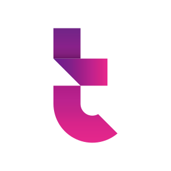

<p align="center">
  
</p>

# Tether

Tether is a coding agent harness that runs entirely on an Android phone. It works like Claude Code, Codex, or OpenCode: you describe a task, the agent reads and edits files, runs commands, and shows you diffs to approve. There is no PC in the loop and no Tether server. You bring your own keys for Anthropic, OpenAI, Google Gemini, DeepSeek, or OpenRouter. Code runs in an on-phone sandbox or Linux environment, and heavy builds go to GitHub Actions.

**Status: early scaffold (phase P0).** The app builds, starts on an emulator, and calls into the Rust core. There are no providers, sessions, or tools yet. See [docs/progress-tracker.md](docs/progress-tracker.md) for where the project is and [docs/build-plan.md](docs/build-plan.md) for what comes next.

Docs site: [khanblair.github.io/tether](https://khanblair.github.io/tether/)

## What is planned for v1

- Five model providers with streaming and tool use
- Projects on the phone, cloned from GitHub or imported
- Five permission modes, plan mode, diffs per hunk, checkpoints, and rewind
- Three executors: WASM sandbox, Linux mode (PRoot), and GitHub Actions
- Git and pull requests with push guards
- A quality gate for code smells and AI slop
- Skills in the open `SKILL.md` format, capped memory, and an Obsidian-compatible vault with a link map
- Cost tracking per turn, session, and project

The full definition is in [docs/product-scope.md](docs/product-scope.md).

## Build and run

You need a computer to build Tether. Using it does not need one.

```
git clone https://github.com/khanblair/tether.git
cd tether
just setup    # checks tools, installs the pinned Rust toolchain, cargo-ndk, and Node packages
just run      # builds the full flavor, installs it on a connected device or emulator, starts it
```

Requirements: Rust (pinned by `rust-toolchain.toml`), JDK 21, Android SDK platform 37 with NDK 27.1.12297006, Node 22.18 or newer with pnpm, and `just`. [docs/development.md](docs/development.md) has the full list, the everyday commands, and troubleshooting.

Run `just check` before every push. It runs the formatters, linters, tests, the slop and file length checks, and the bindings check.

## Repository layout

| Folder | Contents |
|---|---|
| `core/` | Rust workspace: the shared engine, built as `libtether_core.so` and called from Kotlin through UniFFI |
| `android/` | Android app (Gradle): `app`, `core-bridge`, and `designsystem` modules |
| `docs/` | The 14 project docs, also published as the docs site |
| `tokens/` | Design tokens: one JSON file generates the Kotlin, Android, and CSS values |
| `images/` | Logo and exported icons |
| `tools/` | `slop-lint`, file length check, binding and icon generators, docs site builder |
| `runtimes/`, `linux/`, `bench/`, `ios/` | Planned: sandbox runtimes, Linux mode, benchmarks, iOS (v2) |
| `.github/` | CI, release, and Pages workflows |

Every file is described in [docs/project-structure.md](docs/project-structure.md).

## Design

The palette is Velvet Plum, with light and dark themes. IBM Plex Sans and IBM Plex Mono are bundled. See [docs/ui-tokens.md](docs/ui-tokens.md).

## License

No license has been chosen yet, so all rights are reserved for now. The decision is tracked as open question Q5 in [docs/product-scope.md](docs/product-scope.md). The bundled IBM Plex fonts are under the SIL Open Font License; see `android/designsystem/FONTS-LICENSE.txt`.
